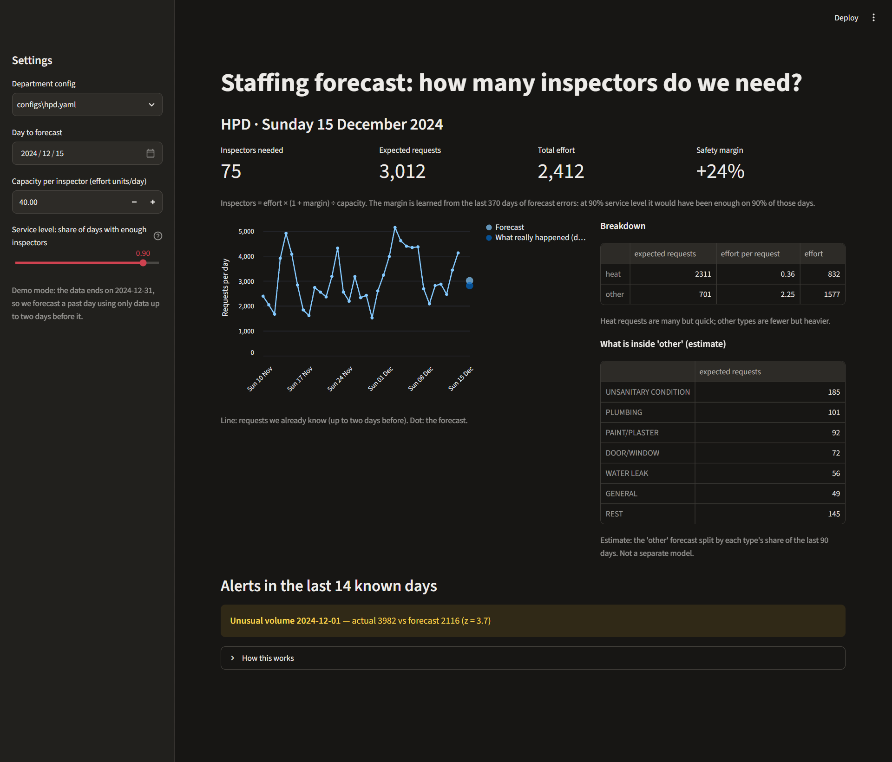

# Previsione del carico di lavoro e pianificazione degli ispettori con NYC 311

🇬🇧 [English version](README.md)

Il sistema prevede quante richieste di servizio riceverà un dipartimento della città di New York **con due giorni di anticipo**. Traduce la previsione in un **carico di lavoro stimato** e in un **numero di ispettori da assegnare**. Genera anche **avvisi** quando il volume delle richieste è anomalo o i dati mostrano possibili problemi.

Il progetto usa i dati reali di NYC 311 del 2023 e del 2024 e si concentra soprattutto sull’HPD, il dipartimento per la tutela e lo sviluppo dell’edilizia abitativa. Per aggiungere un dipartimento basta un nuovo file di configurazione.



## Cosa vede chi pianifica il personale

- Il numero di richieste attese e il carico di lavoro stimato per dopodomani.
- Il numero di ispettori da assegnare, con un margine di sicurezza calcolato in base al **livello di servizio** scelto. Per esempio, con un livello del 90%, l’obiettivo è avere abbastanza ispettori per coprire il carico effettivo nel 90% delle giornate.
- Avvisi per volumi insoliti e possibili problemi di qualità dei dati.
- Tre modi di distribuire gli interventi della giornata tra gli ispettori, confrontati in base all’equilibrio dei carichi e alla priorità data agli interventi urgenti.

## Risultati

La valutazione copre tutti i mesi del 2024. Per ogni mese, il modello è stato riaddestrato usando solo i dati dei mesi precedenti. Le giornate con interruzioni note nella registrazione dei dati sono state gestite come descritto nella sezione sulla qualità dei dati. L’errore è misurato con il **WAPE**, cioè la somma degli errori assoluti divisa per la somma dei valori osservati. Più basso è il WAPE, più accurata è la previsione.

| Errore sul numero di richieste (WAPE) | DOT | DSNY | HPD |
|---|---:|---:|---:|
| Baseline: media dello stesso giorno della settimana nelle quattro settimane precedenti | 13,9% | 12,8% | 25,8% |
| **Modello finale: regressione di Poisson** | **10,6%** | **10,6%** | **17,2%** |
| Riduzione relativa dell’errore rispetto alla baseline | 24% | 17% | 33% |

Per l’HPD:

- **Carico di lavoro.** Il WAPE scende al **12,4%** quando le richieste vengono convertite in unità di lavoro.
- **Bias.** L’errore medio con segno è pari a **+1,3%**, un valore vicino allo zero.
- **Margine di sicurezza.** Un margine fisso del **10%** sarebbe bastato nel **70%** delle giornate. Per raggiungere una copertura del **90%** è servito un margine del **24%**. Per arrivare al **95%** è servito un margine del **49%**. Con un organico dimensionato sulla sola previsione puntuale, la capacità sarebbe risultata insufficiente in circa metà delle giornate. L’app calibra quindi il margine sugli errori storici.
- **Avvisi.** Nel periodo di valutazione, il sistema ha segnalato **15** giornate anomale per l’HPD, **16** per il DOT e **4** per il DSNY.

## Come avviare il progetto

```bash
pip install -r requirements.txt
python scripts/download_311.py                 # Scarica i dati (richiede qualche minuto)
python scripts/load_to_sqlite.py               # Crea il database data/311.db
streamlit run app.py                          # Avvia l’interfaccia web
python -m engine.run --config configs/hpd.yaml --date 2024-12-18
python -m pytest -q                            # Esegue i test
```

Per riprodurre i risultati del README:

```bash
python -m scripts.compare_models    # Confronta baseline e modelli
python -m scripts.check_bias        # Calcola bias e margini di sicurezza
python -m scripts.compare_groups    # Confronta 2 gruppi con 7 gruppi
```

## Come funziona

1. **Pulizia dei dati** (`engine/data.py`). Segnala le date incoerenti e le chiusure istantanee. Uniforma le etichette dei tipi di segnalazione scritte con maiuscole e minuscole diverse.
2. **Previsione** (`engine/forecast.py`). La regressione di Poisson usa il giorno della settimana, le festività e i volumi recenti. Per l’HPD, il modello prevede separatamente le richieste relative al riscaldamento e tutte le altre. La temperatura entra solo nel modello per il riscaldamento.
3. **Stima del carico** (`engine/workload.py`). Il peso di una richiesta è pari alla mediana dei tempi di risoluzione del suo gruppo divisa per la mediana complessiva. Il fabbisogno di ispettori si calcola moltiplicando il carico previsto per `(1 + margine)` e dividendo il risultato per la capacità giornaliera di un ispettore.
4. **Margine di sicurezza** (`engine/risk.py`). Il sistema usa il quantile degli errori di previsione degli ultimi 365 giorni corrispondente al livello di servizio scelto.
5. **Avvisi** (`engine/anomaly.py`). Uno z-score robusto, calcolato usando gli errori di previsione dei 60 giorni precedenti, individua volumi anomali. Un secondo controllo segnala i giorni con volumi molto inferiori a quelli tipici dello stesso giorno della settimana, un possibile indizio di dati incompleti.
6. **Assegnazione degli interventi** (`engine/allocate.py`). L’app confronta l’assegnazione a rotazione (*round robin*), un algoritmo *greedy* che dà priorità agli interventi urgenti e un metodo di ottimizzazione basato su OR-Tools CP-SAT.
7. **Configurazione dei dipartimenti** (`configs/`). Ogni file YAML specifica l’agenzia, i gruppi di segnalazioni, le date con dati incompleti, la capacità per ispettore e il livello di servizio.

```text
engine/      Moduli del motore e interfaccia a riga di comando
configs/     Un file YAML per ciascun dipartimento
scripts/     Download, caricamento dei dati e riproduzione dei risultati
notebooks/   Analisi esplorative ed esperimenti, inclusi quelli scartati
tests/       Test automatici
app.py       Interfaccia web
```

## Esperimenti e scelte progettuali

| Decisione | Alternative provate | Risultati | Scelta finale |
|---|---|---|---|
| Modello | Regressione di Poisson, regressione ridge, gradient boosting, random forest | WAPE per HPD / DOT / DSNY, in percentuale. Poisson 17,2 / 10,6 / 10,6. Ridge 16,7 / 10,7 / 10,7. Gradient boosting 22,4 / 13,6 / 13,1. Random forest 20,8 / 11,7 / 11,8. | **Poisson.** I due modelli lineari hanno superato i modelli ad alberi. Ridge ha registrato un errore circa il 3% più basso per l’HPD, mentre Poisson ha ottenuto risultati leggermente migliori per DOT e DSNY. Poisson è adatta a modellare conteggi e produce previsioni non negative. |
| Mese come variabile | Con e senza il mese | In `notebooks/01_explore.ipynb`, includere il mese ha peggiorato le previsioni. | Mese escluso. |
| Temperatura | Con e senza dati meteo | Nei test del notebook, la temperatura ha migliorato le previsioni delle richieste di riscaldamento dell’HPD. Per le altre agenzie non sono emersi miglioramenti. | Temperatura usata solo per il gruppo riscaldamento dell’HPD. |
| Riscaldamento e altre richieste | Un modello unico oppure due modelli distinti | Le richieste relative al riscaldamento sono numerose e si risolvono più rapidamente. Modellarle separatamente ha migliorato la stima del carico di lavoro. | Due gruppi per l’HPD. |
| Suddivisione del gruppo «altre richieste» | 2 gruppi complessivi oppure 7 | Con 2 e 7 gruppi, il WAPE sul carico è rispettivamente del 12,4% e del 12,3%. Nello stesso confronto, i margini per una copertura del 90% sono del 20,6% e del 20,1%. | Due gruppi. La soluzione con sette modelli richiede circa il triplo del tempo di calcolo. L’app stima il dettaglio delle «altre richieste» in base alle proporzioni osservate di recente. |
| Margine di sicurezza | Margine fisso del 10% | Il margine fisso copriva il carico effettivo nel 70% delle giornate. | Margine calibrato sugli errori storici in base al livello di servizio. |
| Assegnazione | Rotazione, greedy per urgenza, ottimizzazione | Con 300 interventi sintetici e 39 ispettori, il carico massimo per ispettore è stato rispettivamente di 11,6 / 8,6 / 7,3 unità. La differenza tra il carico massimo e quello minimo è stata di 8,0 / 2,3 / 0,6 unità. | Nel test, l’ottimizzazione ha distribuito il carico in modo più uniforme. Il metodo greedy ha dato precedenza agli interventi urgenti. |
| Valutazione | Un’unica suddivisione tra addestramento e test oppure riaddestramento mensile | Il riaddestramento mensile riproduce l’ordine cronologico con cui si accumulano i dati sulle richieste. | Valutazione con riaddestramento mensile sui dati dei mesi precedenti. |

## Problemi riscontrati nei dati

- I tipi di segnalazione scritti con maiuscole e minuscole diverse, come `Heat/Hot Water` e `HEAT/HOT WATER`, venivano conteggiati separatamente. Le etichette sono state uniformate in maiuscolo.
- Le richieste chiuse prima della loro apertura o nello stesso istante sono state escluse dal calcolo dei tempi di risoluzione.
- Per l’HPD, dall’11 al 15 aprile e dall’11 al 14 luglio 2024 sono state registrate zero richieste. Queste giornate sono state escluse dall’addestramento e dal calcolo degli avvisi. Per le variabili che usano i conteggi dei giorni precedenti, i valori mancanti sono stati sostituiti con la media dello stesso giorno della settimana di due e tre settimane prima.
- Il 16 e il 17 marzo 2024 si sono osservati volumi molto bassi. Il 19 marzo si è invece registrato un picco di **5.285 richieste**, a fronte di **2.691 previste**. La causa di questi scostamenti resta sconosciuta. Le giornate sono state mantenute nei dati e segnalate dal sistema.

## Limiti

- Le impostazioni del modello sono state scelte anche alla luce dei risultati del 2024. Gli errori riportati potrebbero quindi essere leggermente ottimistici. Una valutazione indipendente sui dati del 2025 permetterebbe di verificare le prestazioni.
- I **tempi di risoluzione sono un indicatore indiretto del carico** e comprendono anche i tempi di attesa. La capacità giornaliera per ispettore è un parametro da impostare in base all’operatività del dipartimento.
- Nei test, il modello usa la **temperatura osservata nel giorno da prevedere**. In produzione servirebbe un servizio di previsioni meteo che fornisca la temperatura attesa con due giorni di anticipo.
- Le previsioni sono meno accurate nei giorni successivi alle festività. Il modello, al momento, riconosce la festività stessa ma non il giorno successivo.
- Il dettaglio delle «altre richieste» per tipo di segnalazione è stimato in base alle proporzioni osservate di recente. La previsione del modello riguarda il totale del gruppo.
- **Modalità demo.** I dati arrivano al 31 dicembre 2024. L’app simula previsioni per date passate usando lo storico delle richieste disponibile due giorni prima. Per il meteo vale il limite descritto sopra.

## Fonti dei dati

- **NYC Open Data**, dataset *311 Service Requests* (`erm2-nwe9`). Richieste aperte tra il 1° gennaio 2023 e il 31 dicembre 2024 per HPD, DOT e DSNY, di cui circa 1,4 milioni per l’HPD.
- **Open-Meteo**, dati storici sulla temperatura.
