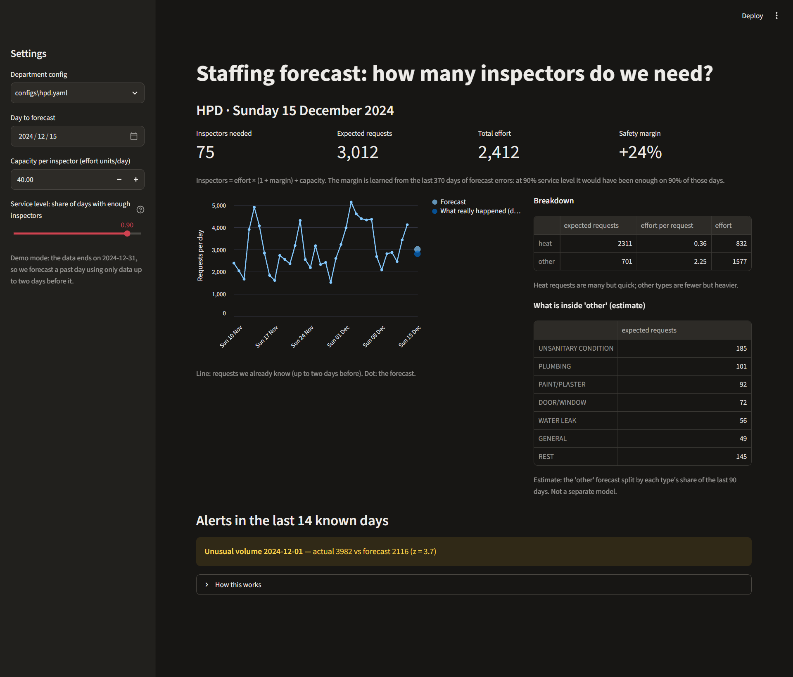

# Workload Forecasting and Staffing Engine (NYC 311)

🇮🇹 [Versione italiana](README.it.md)

Forecasts how many service requests a city agency will receive **two days ahead**, turns the forecast into a **workload and a number of inspectors**, and raises **alerts** when the volume or the data looks wrong. It is built on real NYC 311 data (2023–2024), mainly for the housing agency (HPD), and a new department only needs a new config file.

 

## What a manager gets
- Expected requests and workload for the day after tomorrow.
- The number of inspectors needed, with a safety margin the manager chooses as a **service level** ("enough inspectors on 90% of days").
- Alerts for unusual volume and for possible data problems.
- Three ways to split a day's tasks between inspectors, compared on fairness and urgency.

## Results
Tested on every day of 2024. Each month was predicted by a model trained **only on earlier data** (retrained month by month), so the future is never used. Error is WAPE (the average error as a percentage of the real counts; lower is better).

| Request count error (WAPE) | DOT | DSNY | HPD |
|---|---|---|---|
| Simple rule: average of the same weekday over the last 4 weeks | 13.9% | 12.8% | 25.8% |
| **Final model (Poisson regression)** | **10.6%** | **10.6%** | **17.2%** |
| Improvement over the rule | 24% | 17% | 33% |

Other results (HPD):
- **Workload error** (requests converted to effort): 12.4%.
- **Bias:** the average error is +1.3%, so the forecast is not systematically too high or too low.
- **Safety margin:** a fixed 10% margin would have been enough on only **70%** of days. A margin of **24%** covers 90% of days, and **49%** covers 95%. A forecast is an average, so a manager who staffs exactly to it is short on about half of the days. This is why the app learns the margin from past errors.
- **Alerts:** in the test period the alert system flagged 15 unusual days for HPD, 16 for DOT and 4 for DSNY.

## Run it
```
pip install -r requirements.txt
python scripts/download_311.py                 # download the data (a few minutes)
python scripts/load_to_sqlite.py               # build data/311.db
streamlit run app.py                           # web interface
python -m engine.run --config configs/hpd.yaml --date 2024-12-18    # command line
python -m pytest -q                            # tests
```

To reproduce the numbers in this README:
```
python -m scripts.compare_models    # baselines and model comparison
python -m scripts.check_bias        # bias and safety margin
python -m scripts.compare_groups    # 2 groups vs 7 groups
```

## How it works
1. **Clean** (`engine/data.py`): flags impossible dates and instant closes, and merges complaint types written in different upper/lower case.
2. **Forecast** (`engine/forecast.py`): Poisson regression on the weekday, holidays, recent request levels and, for heating complaints, the temperature. Heating complaints and all others are forecast separately.
3. **Workload** (`engine/workload.py`): the effort of one request is the median resolution time of its group divided by the overall median. Inspectors needed = effort × (1 + margin) ÷ capacity per inspector.
4. **Risk** (`engine/risk.py`): the margin is the quantile of the forecast errors of the last 365 days, for the chosen service level.
5. **Alerts** (`engine/anomaly.py`): a robust z-score of the forecast error over the previous 60 days flags unusual volume. A separate check flags days far below a normal day of the same weekday, which usually means a data problem.
6. **Allocation** (`engine/allocate.py`): round robin, greedy by urgency, and optimal (OR-Tools CP-SAT).
7. **Departments:** each one is a file in `configs/` (agency, complaint groups, broken-data days, capacity, service level).

```
engine/      final code (data, forecast, workload, risk, anomaly, allocate, run)
configs/     one .yaml file per department
scripts/     data download and loading, plus scripts that reproduce the results
notebooks/   exploration, including ideas that were tried and rejected
tests/       automatic tests
app.py       web interface
```

## Decisions: what I tried and what I kept
| Decision | Tried | Evidence | Kept |
|---|---|---|---|
| Model | Poisson regression, ridge, gradient boosting, random forest | WAPE for HPD / DOT / DSNY: Poisson 17.2 / 10.6 / 10.6, Ridge 16.7 / 10.7 / 10.7, gradient boosting 22.4 / 13.6 / 13.1, random forest 20.8 / 11.7 / 11.8 | **Poisson.** The two linear models beat the tree models. Poisson ties with Ridge (Ridge is 3% better on HPD); I chose Poisson because it models counts and never predicts negative numbers |
| Month as a feature | with / without | tested in `notebooks/01_explore.ipynb`: it made the forecast worse | without |
| Weather | with / without | tested in the notebook: it helps HPD (heating complaints), not the other agencies | HPD heating group only |
| Heating vs other | one model for everything / two groups | tested in the notebook: heating requests are many but quick to resolve, so splitting gives a much better workload forecast | two groups |
| Splitting "other" into 6 more types | 2 groups vs 7 groups | workload error 12.4% vs 12.3%, margin for 90% of days 20.6% vs 20.1% | 2 groups: seven models are about 3× slower for no real gain. The app shows an *estimated* split of "other" by recent shares |
| Safety margin | fixed 10% | enough on only 70% of days | service level learned from past errors |
| Allocation | round robin, greedy, optimal | on 300 synthetic tasks and 39 inspectors: busiest inspector 11.6 / 8.6 / 7.3, load gap 8.0 / 2.3 / 0.6 | trade-off documented: optimal is the fairest, greedy starts urgent tasks sooner |
| Evaluation | single train/test split | rolling monthly retraining | rolling: no future data is ever used |

## Data issues found
- Complaint types in mixed case (`Heat/Hot Water` vs `HEAT/HOT WATER`) were counted separately: fixed by upper-casing.
- Requests closed before they were created, or at the very same instant: excluded from resolution-time statistics.
- HPD reporting gaps (zero requests) on 11–15 April and 11–14 July 2024: kept out of training and alerts, and filled in the lag features with the average of the same weekday 2 and 3 weeks earlier.
- 16–17 March 2024 (very low) and 19 March 2024 (a spike: 5,285 requests against a forecast of 2,691) are unexplained. They are kept in the data, and the alert system flags them.

## Limitations
- The model settings were chosen while looking at the 2024 results, so the errors above may be slightly optimistic. A test on 2025 data would confirm them.
- **Effort is a proxy** (resolution time), not real working hours. **Capacity per inspector is an assumption**; a real user would enter their own.
- The forecast uses the actual weather of the forecast day. A live system would need a weather forecast service.
- Days after holidays are forecast poorly, because there is no feature for them yet.
- The split of "other" by type is an estimate (recent shares), not a separate forecast.
- Demo mode: the data ends on 31 December 2024, so the app forecasts past days using only the data available two days earlier.

## Data
NYC Open Data, *311 Service Requests* (dataset `erm2-nwe9`), agencies HPD, DOT and DSNY, created between 2023-01-01 and 2024-12-31 (about 1.4 million HPD requests). Weather: Open-Meteo.
